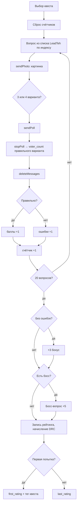

# Drive or Die — квиз-игра по ПДД в Telegram

Геймифицированный тренажёр билетов ПДД для курсантов автошколы: зомби-апокалипсис, персонажи, 40 квестов, босс-вопросы, рейтинг и внутренняя валюта. Собран на **LeadTeh** + **Telegram Bot API** + **Google Sheets**.

> Сценарии спроектированы и собраны мной вручную в конструкторе LeadTeh: логика, тексты, интеграции с CRM и Google Sheets.

## Механика

- 20 вопросов в квесте, вопрос показывается **нативным опросом Telegram** с картинкой.
- **+1** за правильный ответ, **+3** за квест без ошибок, **+5** за босс-вопрос (каждый 4-й квест).
- В рейтинг идёт **только первая попытка** (отмечается тегом с номером квеста), остальные — тренировка.
- Баллы конвертируются во внутреннюю валюту **DRC** с потолком накопления; DRC тратятся в магазине мерча.
- Рейтинг — в Google Sheets и DataLens.

## Как работает движок

Главный трюк — **определение правильного ответа без кнопок**: бот отправляет опрос от имени бота, после ответа закрывает его `stopPoll` и читает `result.options[по].voter_count` — если 1, игрок выбрал правильный вариант.

## Сценарии

| Сценарий | | Описание |
|---|---|---|
| Главное меню | [схема](scenarios/main_menu.md) · [json](scenarios/main_menu.json) | Хаб игры: новая игра, продолжить, рейтинг, призы, интро, баг-репорт, магазин |
| Новая игра | [схема](scenarios/new_game.md) · [json](scenarios/new_game.json) | Выбор персонажа (Руслан / Катя), сюжетное интро и правила начисления баллов |
| Меню квестов | [схема](scenarios/quiz_menu.md) · [json](scenarios/quiz_menu.json) | 40 квестов (билетов ПДД) двумя страницами кнопок; выбор пишется в переменную `Квест` и запускает движок |
| Движок квиза (quiz_master) | [схема](scenarios/quiz_master.md) · [json](scenarios/quiz_master.json) | Универсальный движок: по номеру квеста берёт вопросы из списка LeadTeh, показывает картинку и нативный Telegram-опрос (sendPoll), закрывает опрос (stopPoll) и по voter_count определяет правильность, считает баллы/ошибки, бонус +3 за прохождение без ошибок, босс-вопрос +5, пишет рейтинг первой и последней попытки в Google Sheets и начисляет внутреннюю валюту DRC с лимитом |
| Рейтинг | [схема](scenarios/rating.md) · [json](scenarios/rating.json) | Рейтинг игроков из Google Sheets и дашборд в DataLens |
| Магазин | [схема](scenarios/shop.md) · [json](scenarios/shop.json) | Каталог мерча/сертификатов за внутреннюю валюту DRC: inline-поиск, карточка товара, корзина |
| Баг-репорт | [схема](scenarios/bug_report.md) · [json](scenarios/bug_report.json) | Сбор обратной связи и скриншота, запись в Google Sheets |

Ранние версии (Quiz_1…Quiz_4 с вопросами, зашитыми в схему) заменены универсальным `quiz_master` и в репозиторий не вошли.

## Как читать выгрузку

Каждый блок: `id`, `type`, `messages`/`http`/`conditions`/`vars`, `buttons` с переходами `next`. Токен Telegram-бота, ID таблиц и дашборда заменены на `<PLACEHOLDER>`.
