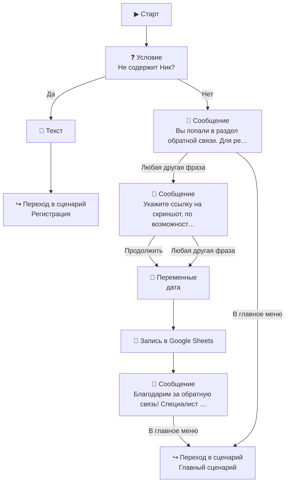

# Баг-репорт

Сбор обратной связи и скриншота, запись в Google Sheets.

## Схема

## Переменные

`bag_scr`, `bag_report`, `Дата`

Полная выгрузка блоков — в соседнем `.json` (секреты заменены плейсхолдерами).
