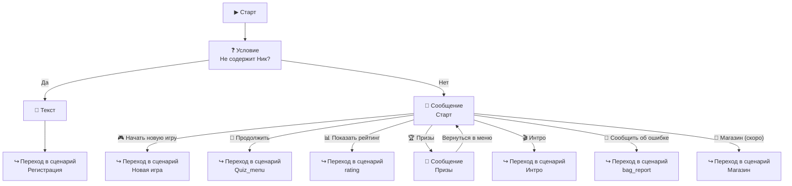

# Главное меню

Хаб игры: новая игра, продолжить, рейтинг, призы, интро, баг-репорт, магазин. Доступ только после регистрации (тег «Ник»).

## Схема

## Переменные

`SAVE`

Полная выгрузка блоков — в соседнем `.json` (секреты заменены плейсхолдерами).
