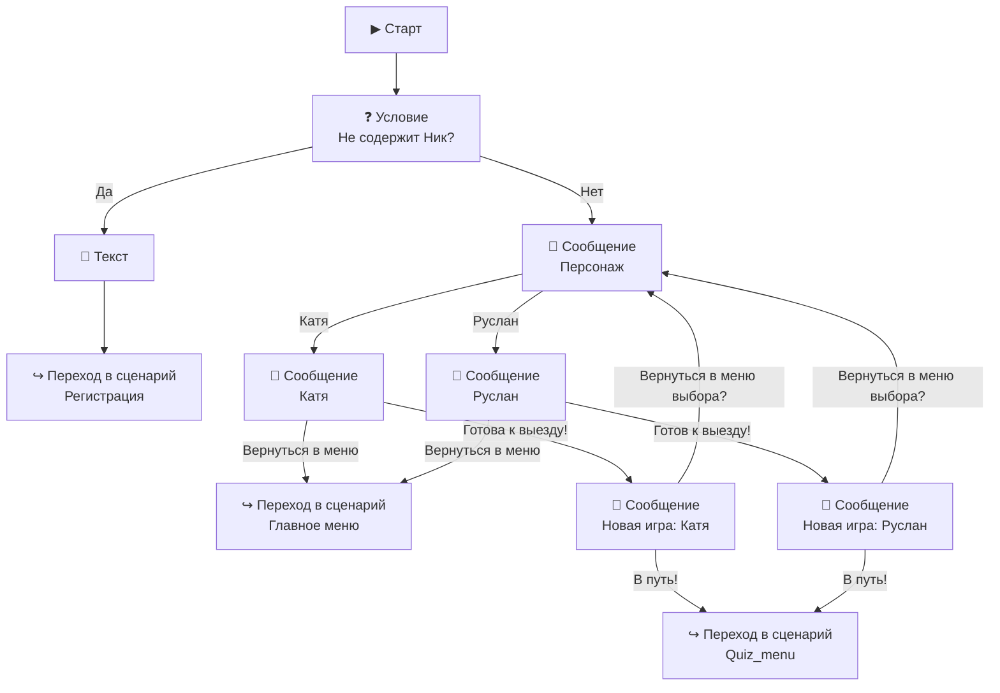

# Новая игра

Выбор персонажа (Руслан / Катя), сюжетное интро и правила начисления баллов.

## Схема

## Переменные

`SAVE`

Полная выгрузка блоков — в соседнем `.json` (секреты заменены плейсхолдерами).
