# Движок квиза (quiz_master)

Универсальный движок: по номеру квеста берёт вопросы из списка LeadTeh, показывает картинку и нативный Telegram-опрос (sendPoll), закрывает опрос (stopPoll) и по voter_count определяет правильность, считает баллы/ошибки, бонус +3 за прохождение без ошибок, босс-вопрос +5, пишет рейтинг первой и последней попытки в Google Sheets и начисляет внутреннюю валюту DRC с лимитом.

## Схема

```mermaid
flowchart TD
  s1["🌐 HTTP-запрос<br/>sendPhoto В бой!"]
  s2["🧮 Переменные<br/>up_to_maxDRC"]
  s3["🧮 Переменные<br/>maxDRC"]
  s4["🧮 Переменные<br/>DRC"]
  s5["❓ Условие<br/>up_to_maxDRC DRC"]
  s6["📗 Чтение Google Sheets"]
  s7["💬 Сообщение<br/>Баланс"]
  s8["🧮 Переменные"]
  s9["🌐 HTTP-запрос<br/>sendPhoto_right"]
  s10["🧮 Переменные<br/>баллы + 5"]
  s11["🌐 HTTP-запрос<br/>sendPhoto_wrong"]
  s12["🌐 HTTP-запрос<br/>sendPoll4"]
  s13["❓ Условие<br/>правильно?"]
  s14["🌐 HTTP-запрос<br/>deleteMessages"]
  s15["🌐 HTTP-запрос<br/>stopPoll"]
  s16["🧮 Переменные<br/>обработка правильного ответа"]
  s17["🌐 HTTP-запрос<br/>sendPoll3"]
  s18["❓ Условие<br/>3 или 4 варианта?"]
  s19["🧮 Переменные<br/>БОСС"]
  s20["🌐 HTTP-запрос<br/>sendPhoto"]
  s21["🌐 HTTP-запрос<br/>Викторина (босс-вопрос)"]
  s22["❓ Условие<br/>есть босс?"]
  s23["⚙️ JavaScript<br/>Переход на следующий квест"]
  s24["⚙️ JavaScript<br/>Проверка первой попытки (теги)"]
  s25["📗 Чтение Google Sheets"]
  s26["🧮 Переменные<br/>DRC"]
  s27["📗 Запись в Google Sheets<br/>Зачисление DRC"]
  s28["🧮 Переменные<br/>maxDRC"]
  s29["💬 Сообщение<br/>без единой ошибки"]
  s30["🧮 Переменные<br/>баллы + 3"]
  s31["❓ Условие<br/>все ответы правильные?"]
  s32["📗 Запись в Google Sheets<br/>last_rating"]
  s33["🧮 Переменные<br/>дата"]
  s34["💬 Сообщение<br/>Повторная попытка"]
  s35["📗 Запись в Google Sheets<br/>last_rating"]
  s36["📗 Чтение Google Sheets"]
  s37["📗 Запись в Google Sheets<br/>first_rating"]
  s38["↪ Переход в сценарий<br/>Quiz_menu"]
  s39["🌐 HTTP-запрос<br/>sendPhoto_wrong"]
  s40["🌐 HTTP-запрос<br/>sendPhoto_right"]
  s41["🌐 HTTP-запрос<br/>Викторина: следующий вопрос"]
  s42["🌐 HTTP-запрос<br/>sendPoll3"]
  s43["❓ Условие<br/>3 или 4 варианта?"]
  s44["🧮 Переменные<br/>ошибка + 1"]
  s45["🧮 Переменные<br/>счетчик + 1"]
  s46["🧮 Переменные<br/>индекс правильного ответа (с 0)"]
  s47["↪ Переход в сценарий<br/>Главный сценарий"]
  s48["💬 Сообщение<br/>Первая попытка"]
  s49["❓ Условие<br/>вопросы закончились?"]
  s50["🧮 Переменные<br/>баллы + 1"]
  s51["❓ Условие<br/>правильно?"]
  s52["🌐 HTTP-запрос<br/>deleteMessages"]
  s53["🌐 HTTP-запрос<br/>stopPoll"]
  s54["🌐 HTTP-запрос<br/>sendPhoto (картинка вопроса)"]
  s55["🌐 HTTP-запрос<br/>sendPoll4"]
  s56["🧮 Переменные<br/>обнуление переменных"]
  s57["💬 Сообщение<br/>Удачи😉"]
  s58["▶ Старт"]
  s1 --> s20
  s3 --> s4
  s4 --> s27
  s5 -- "Да" --> s3
  s5 -- "Нет" --> s28
  s6 --> s5
  s7 --> s24
  s8 --> s22
  s9 --> s8
  s10 --> s9
  s11 --> s8
  s12 -- "далее" --> s15
  s13 -- "Да" --> s10
  s13 -- "Нет" --> s11
  s14 --> s13
  s15 --> s14
  s16 --> s19
  s17 -- "далее" --> s15
  s18 -- "Да" --> s17
  s18 -- "Нет" --> s12
  s19 --> s18
  s20 --> s16
  s21 --> s1
  s22 -- "Да" --> s21
  s22 -- "Нет" --> s33
  s23 --> s58
  s25 --> s57
  s26 --> s27
  s27 --> s7
  s28 --> s26
  s29 -- "Продолжить" --> s22
  s30 --> s29
  s31 -- "Да" --> s30
  s31 -- "Нет" --> s22
  s32 --> s48
  s33 --> s28
  s34 -- "Главное меню" --> s47
  s34 -- "Выбор квеста" --> s38
  s35 --> s34
  s36 --> s35
  s37 --> s32
  s39 --> s44
  s40 --> s50
  s41 --> s54
  s42 -- "далее" --> s53
  s43 -- "Да" --> s42
  s43 -- "Нет" --> s55
  s44 --> s45
  s45 --> s49
  s46 --> s43
  s48 -- "Главное меню" --> s47
  s48 -- "Выбор квеста" --> s38
  s48 -- "Следующий квест" --> s23
  s49 -- "Да" --> s31
  s49 -- "Нет" --> s41
  s50 --> s45
  s51 -- "Да" --> s40
  s51 -- "Нет" --> s39
  s52 --> s51
  s53 --> s52
  s54 --> s46
  s55 -- "далее" --> s53
  s56 --> s25
  s57 --> s41
  s58 --> s56
```

## Переменные

`maxDRC`, `DRC`, `boss`, `баллы`, `по`, `босс`, `Дата`, `ошибка`, `счетчик`, `3_ответа`, `Дата старта`, `Период`, `тотал`

## Интеграции

- **sendPhoto В бой!** — `POST https://api.telegram.org/bot<TG_BOT_TOKEN>/sendPhoto`
- **sendPhoto_right** — `POST https://api.telegram.org/bot<TG_BOT_TOKEN>/sendPhoto`
- **sendPhoto_wrong** — `POST https://api.telegram.org/bot<TG_BOT_TOKEN>/sendPhoto`
- **sendPoll4** — `POST https://api.telegram.org/bot<TG_BOT_TOKEN>/sendPoll`
- **deleteMessages** — `POST https://api.telegram.org/bot<TG_BOT_TOKEN>/deleteMessages`
- **stopPoll** — `POST https://api.telegram.org/bot<TG_BOT_TOKEN>/stopPoll`
- **sendPoll3** — `POST https://api.telegram.org/bot<TG_BOT_TOKEN>/sendPoll`
- **sendPhoto** — `POST https://api.telegram.org/bot<TG_BOT_TOKEN>/sendPhoto`
- **Викторина (босс-вопрос)** — `POST https://app.leadteh.ru/api/v1/getListItems`
- **Викторина: следующий вопрос** — `POST https://app.leadteh.ru/api/v1/getListItems`
- **sendPhoto (картинка вопроса)** — `POST https://api.telegram.org/bot<TG_BOT_TOKEN>/sendPhoto`

Полная выгрузка блоков — в соседнем `.json` (секреты заменены плейсхолдерами).
