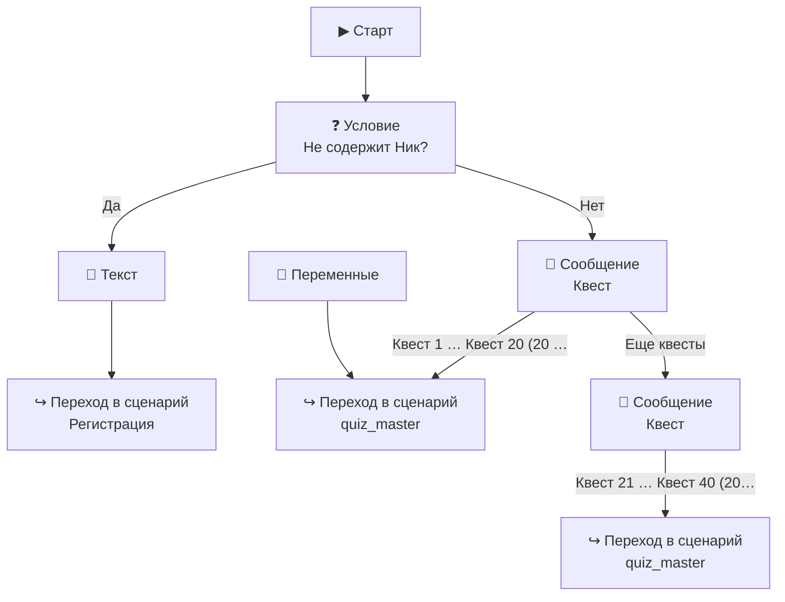

# Меню квестов

40 квестов (билетов ПДД) двумя страницами кнопок; выбор пишется в переменную `Квест` и запускает движок.

## Схема

## Переменные

`Квест`, `boss`

Полная выгрузка блоков — в соседнем `.json` (секреты заменены плейсхолдерами).
