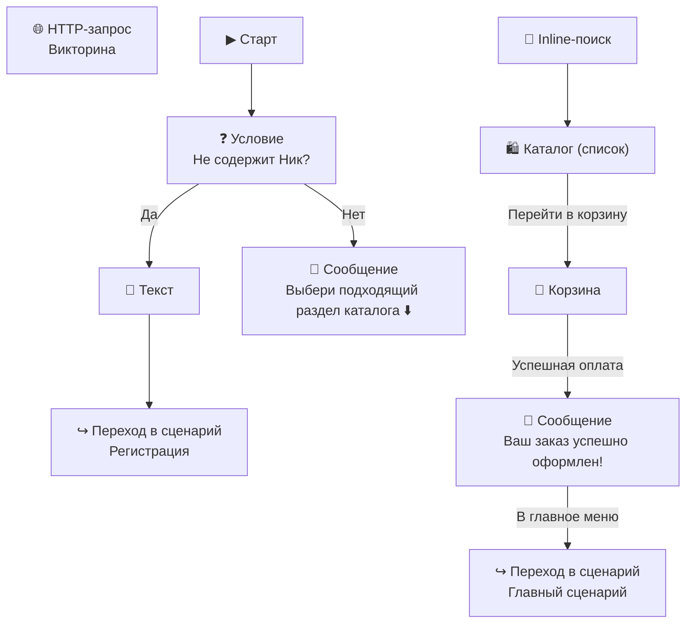

# Магазин

Каталог мерча/сертификатов за внутреннюю валюту DRC: inline-поиск, карточка товара, корзина.

## Схема

## Переменные

`Товар`, `Заказ`

## Интеграции

- **Викторина** — `POST https://app.leadteh.ru/api/v1/getListItems`

Полная выгрузка блоков — в соседнем `.json` (секреты заменены плейсхолдерами).
